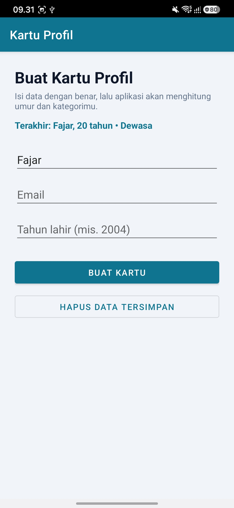
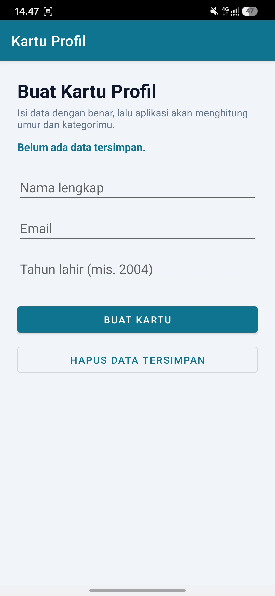

# Kartu Profil

Aplikasi Android (Kotlin) untuk praktikum mata kuliah Pemrograman Mobile.

- **Pertemuan 7:** logika interaktif dan navigasi (validasi, hitung umur, kategori, pindah layar).
- **Pertemuan 9:** penyimpanan data lokal dengan SharedPreferences (lihat bagian *Pertemuan 9* di bawah). Kerangka Room ada di proyek terpisah [RoomLatihan](https://github.com/FajarRahmadani/RoomLatihan).

Pengguna mengisi nama, email, dan tahun lahir. Aplikasi memeriksa input, menghitung umur dan kategori, lalu mengirim hasilnya ke layar kedua yang menampilkan kartu profil.

## Pertemuan 7: Input > Proses > Output

| Tahap | Isi |
|-------|-----|
| Input | Nama, email, tahun lahir (`MainActivity`) |
| Proses | Validasi berlapis > konversi `toIntOrNull()` > hitung umur > kategori `when` |
| Output | `Intent.putExtra` ke `SecondActivity` yang menampilkan kartu |

Validasi berlapis (berhenti di kesalahan pertama, error muncul di kolom yang salah dan fokus pindah ke sana):

1. Nama tidak boleh kosong
2. Email tidak kosong dan berformat valid (`Patterns.EMAIL_ADDRESS`)
3. Tahun lahir tidak kosong
4. Tahun lahir berupa angka (`toIntOrNull()`, tidak crash)
5. Tahun lahir antara 1950 dan tahun berjalan (diambil dari `Calendar`, tidak ditulis mati)

Kategori umur dengan `when` rentang: Anak (0–12), Remaja (13–17), Dewasa (18–59), Lansia (60+). Tambahan: kategori generasi dan avatar inisial di layar kedua.

## Cara menjalankan

1. Buka folder ini di **Android Studio** dan tunggu Gradle sync selesai.
2. Pilih emulator atau perangkat Android, lalu klik **Run**.

## Struktur

```
app/src/main/
├── java/com/example/kartuprofil/
│   ├── MainActivity.kt      # form, validasi, logika
│   └── SecondActivity.kt    # kartu hasil, inisial
├── res/layout/
│   ├── activity_main.xml
│   └── activity_second.xml
└── AndroidManifest.xml
```

## Pertemuan 9: Penyimpanan Data Lokal (SharedPreferences)

Aplikasi sekarang mengingat data terakhir meski ditutup. Berkas penyimpanan bernama `profil` (`MODE_PRIVATE`, hanya aplikasi ini yang bisa membaca).

| Kunci | Tipe | Isi |
|-------|------|-----|
| `nama_terakhir` | String | Nama yang terakhir lolos validasi |
| `umur_terakhir` | Int | Umur yang dihitung saat data itu disimpan |
| `kategori_terakhir` | String | Anak / Remaja / Dewasa / Lansia |

Semua kunci ditulis sebagai konstanta di `companion object` supaya kunci simpan dan kunci baca selalu sama.

| Latihan | Isi | Commit |
|---------|-----|--------|
| 0 | Bukti data hilang saat aplikasi ditutup (jalankan baseline P7) | `P7: Kartu Profil ...` |
| 1 | Simpan nama & umur dengan `apply()`, hanya setelah validasi lolos, sebelum `startActivity` | `P9 Latihan 1` |
| 2 | Baca di `onCreate`: nama terisi otomatis (`getString(...) ?: ""` + `isNotEmpty()`) | `P9 Latihan 2` |
| 3 | Simpan kategori, `tvStatus` menampilkan "Terakhir: Budi, 22 tahun • Dewasa", tombol **Hapus data tersimpan** (`clear().apply()`) | `P9 Latihan 3` |
| 4 | Kerangka Room (Entity, Dao, Database) di proyek terpisah **RoomLatihan** | repo [RoomLatihan](https://github.com/FajarRahmadani/RoomLatihan) |
| 5 | Perbandingan SharedPreferences vs Room dan refleksi (di bawah) | `P9 Latihan 5` |

Catatan: `tvStatus` menampilkan umur **saat data terakhir disimpan**, bukan dihitung ulang setiap aplikasi dibuka. Bila belum ada data (pertama kali dipasang atau setelah dihapus), `tvStatus` menampilkan teks awal "Belum ada data tersimpan.".

### Cara menguji

1. **Latihan 0 (opsional):** cari commit `P7: Kartu Profil` dengan `git log --oneline`, lalu `git checkout <kode-commit>`, jalankan, isi form, buat kartu, tutup aplikasi sepenuhnya, buka lagi: kolom nama kosong. Lalu `git checkout main`.
2. **Simpan dan baca:** isi nama, email, tahun lahir yang valid, tekan **Buat Kartu**, tutup aplikasi sepenuhnya (swipe dari daftar aplikasi terbaru), buka lagi: kolom nama terisi dan `tvStatus` menampilkan nama, umur, dan kategori.
3. **Validasi:** isi tahun lahir `2099` atau kosongkan nama, tekan **Buat Kartu**: muncul error dan data lama di `tvStatus` tidak berubah (data tidak valid tidak disimpan).
4. **Hapus lewat tombol:** tekan **Hapus data tersimpan**, tutup aplikasi, buka lagi: kolom nama kosong dan `tvStatus` kembali ke teks awal.
5. **Hapus lewat Pengaturan:** simpan data lagi, lalu Pengaturan HP > Aplikasi > Kartu Profil > Penyimpanan > Hapus data. Buka aplikasi: kolom kosong dan aplikasi tidak crash.

### Tangkapan layar

|          (a) Nama terisi otomatis setelah buka ulang           |             (b) Kolom kosong setelah hapus data aplikasi             |
|:--------------------------------------------------------------:|:--------------------------------------------------------------------:|
|  |  |

### Latihan 5: SharedPreferences vs Room

| | SharedPreferences | Room |
|---|---|---|
| Bentuk data | Satu-dua nilai, kunci-nilai | Daftar/baris terstruktur |
| Contoh di modul | Nama & umur terakhir | Tabel catatan |
| Menambah data | Menimpa kunci yang sama | Menambah baris baru |
| Mencari/mengurutkan | Tidak cocok | Query SQL (`ORDER BY`, `WHERE`) |
| Biaya belajar | Rendah: tiga baris simpan | Lebih tinggi: Entity, Dao, Database, coroutine |

Aturan praktis: data yang bisa dihitung dengan jari dan tidak perlu dicari cukup SharedPreferences (itu sebabnya Kartu Profil tetap memakainya); daftar yang bertambah dan perlu dicari memakai Room.

### Refleksi

1. **Tiga aplikasi yang datanya harus tetap ada:** aplikasi catatan, daftar yang bertambah dan dicari, jadi **Room**; aplikasi chat, riwayat pesan yang panjang dan berurutan, jadi **Room**; pengaturan tema gelap atau bahasa di aplikasi apa pun, satu nilai kecil, jadi **SharedPreferences**.
2. **Mengapa disimpan setelah validasi lolos:** bila data yang salah (nama kosong, tahun lahir 2099) ikut tersimpan, aplikasi akan "mengingat" dan menampilkan data salah itu setiap dibuka, dan bisa menyebabkan hasil yang tidak masuk akal (umur negatif). Dengan validasi dulu, penyimpanan hanya berisi data yang layak.
3. **Peran Room:** Entity adalah satu class yang mewakili satu baris tabel; Dao adalah interface berisi perintah menyimpan, membaca, dan menghapus; Database adalah penghubung yang mendaftarkan entity dan menyediakan akses ke Dao. Contoh lengkapnya ada di proyek [RoomLatihan](https://github.com/FajarRahmadani/RoomLatihan).